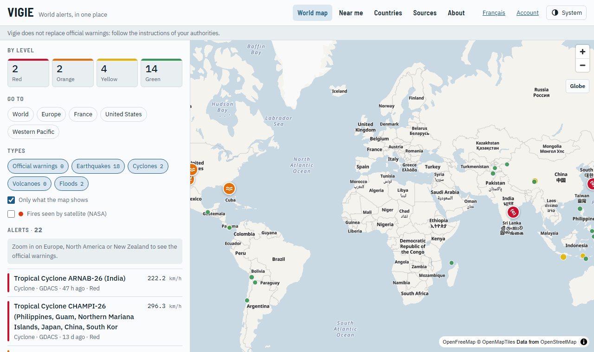

# Vigie Web

A personal project, made with the help of AI and shared in case it helps someone. It comes as is, with
no promise of support, availability or accuracy.

Vigie Web is a website that shows on maps the world natural hazards (earthquakes, cyclones, volcanoes,
floods…) and the official weather warnings that the [Vigie API](https://github.com/Axellum/vigie-api)
gathers from public sources. It does not call any data provider itself: it reads one Vigie API instance,
which caches every feed once for everybody.

> **This is not an official warning service.** The alerts are relayed from public feeds. They can be
> late, incomplete or wrong. Follow the warnings of your national authorities.

Public instance: <https://vigie.auxfilsdesidees.fr>



## What it shows

- a world map of the current hazards and, for the covered countries, of the official warnings, opening on "the point":
  what is red in the world, then what counts, the API's events (`/v1/events`) the strongest first;
- a list that follows the map, with filters by level and by type;
- a page for each country and each area, and a page for each alert with the issuer's text unchanged;
- "near me": for a place (found by name, the browser's position, a click on the map, or the page's address), the official
  warnings that hold it, the hazards around it, its weather, sea, surf spots, sky and air, in cards that a profile (surf,
  mountain, garden…) orders, with the place in one sentence; the place stays in the browser, only a position
  rounded to the weather grid (about 5 km) is sent, for the weather; places can be followed without an account,
  in the browser only;
- the state of each source, its licence and its credit;
- accounts, by invitation, with passkeys (no password, no e-mail), when the server has a database: export and
  deletion from the account page.

## Run it

Node.js 22 or newer and a running Vigie API.

```
npm ci
VIGIE_API_URL=http://127.0.0.1:8080 npm run dev
```

`npm run build` writes a Node server to `build/` (`node build` starts it). The settings are environment
variables, listed in [`docs/configuration.md`](docs/configuration.md).

## Licence, data and credits

The code is under the [MIT licence](LICENSE). The data is not: it belongs to each provider and stays under
that provider's terms, which the Vigie API lists in its `SOURCES.md`. Every page shows the credit of the
sources it displays. The base map is © OpenMapTiles and © OpenStreetMap contributors, served by
OpenFreeMap. The places of the search by name come from [GeoNames](https://www.geonames.org/) (CC BY 4.0,
`data/places.tsv.gz`), the borders from Natural Earth (public domain).
